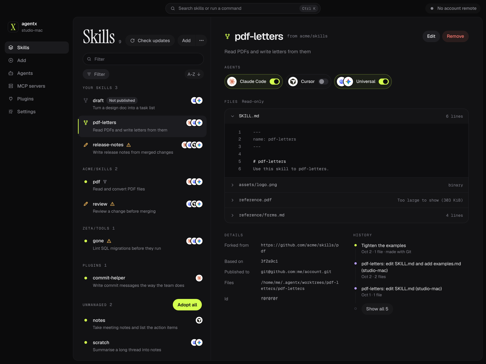

<div align="center">

# AgentX

**Control panel for your agent inventory**

`agentx` discovers skills, MCPs, and plugins from installed agents, allowing you to view, manage, distribute, and sync them across machines.

[](https://github.com/grundmanise/agentx/actions/workflows/ci.yml)
[](apps/cli/go.mod)
[](LICENSE)


</div>

---

## Quick look



## Install

### The app (recommended)

On a Mac with Apple silicon, with [Homebrew](https://brew.sh). This also puts the `agentx` CLI on your `PATH`:

```sh
brew install grundmanise/tap/agentx
```

On Linux, download the `.deb` or the AppImage from the [latest release](https://github.com/grundmanise/agentx/releases/latest). Both carry the CLI; the `.deb` also puts
`agentx` on your `PATH`.

### Alternatively, CLI only

For a machine with no desktop, on macOS or Linux, with Homebrew:

```sh
brew install grundmanise/tap/agentx-cli
```

Or, on Linux or a Mac with Apple silicon, with the install script, which installs only the CLI, to `~/.local/bin`:

```sh
curl -fsSL https://agentx.wtf/install | sh
```

For the newest nightly build, end the install script command with `sh -s -- --nightly`. To update a CLI
that the install script installed, run `agentx update`. See [Install and update](https://docs.agentx.wtf/install)
for options, updates and uninstalling.

agentx needs `git` 2.40 or later on your `PATH`.

### Build from source

To build the CLI, use Go `1.27.1` or later:

```sh
git clone https://github.com/grundmanise/agentx.git
cd agentx/apps/cli && go build -o agentx .
```

On Linux, `CGO_ENABLED=0 go build` produces a static binary. On macOS, build with `cgo` enabled – the
default – so `agentx serve` watches through `FSEvents`; a macOS binary built without `cgo` falls back to
`kqueue`, which costs one file descriptor per watched file.

To build the app, see [`apps/desktop/README.md`](apps/desktop/README.md).

## Documentation

[docs.agentx.wtf](https://docs.agentx.wtf)

## Status

Supports 75 agents:

| Agent | Skills | MCP servers | Plugins |
| --- | :---: | :---: | :---: |
| Claude Code, Codex, Cursor, Gemini CLI | ✓ | ✓ | ✓ |
| Windsurf, GitHub Copilot | ✓ | ✓ | |
| All others | ✓ | | |

> Under active development. The command-line tool already:
>
> - inventories every agent configuration and what it sees: [`agentx scan`](https://docs.agentx.wtf/cli/scan)
> - installs skills from git sources and places them in your agent clients: [`agentx skill add`](https://docs.agentx.wtf/cli/skill#install-a-skill)
> - checks for newer versions and applies them, merging your own edits into each update: [`agentx skill check-updates`](https://docs.agentx.wtf/cli/skill#check-for-updates), [`agentx skill update`](https://docs.agentx.wtf/cli/skill#update-a-skill)
> - takes over the skills the Vercel skills CLI or Skillshare installed, so agentx can update them too: [`agentx adopt`](https://docs.agentx.wtf/cli/adopt)
> - forks skills into your own, with a history you publish to your account remote and install on your other machines: [`agentx skill fork`](https://docs.agentx.wtf/cli/fork), [`agentx skill publish`](https://docs.agentx.wtf/cli/skill#publish-a-skill)
>
> The desktop app is in progress.

## Project docs

| | |
| --- | --- |
| [`GLOSSARY.md`](GLOSSARY.md) | The vocabulary |
| [`docs/adr`](docs/adr) | Architecture decisions |
| [`docs/spec`](docs/spec) | Contracts & Specs |
| [`docs/help-center`](docs/help-center) | Source of the [documentation](https://docs.agentx.wtf) |

## Contributing

Contributions are welcome. [`CONTRIBUTING.md`](CONTRIBUTING.md) covers setting up your machine, the
checks to run and how to open a pull request. Everyone taking part follows the
[Code of Conduct](CODE_OF_CONDUCT.md).

## License

[Apache License 2.0](LICENSE). Copyright 2026 Edgars Grundmanis.
