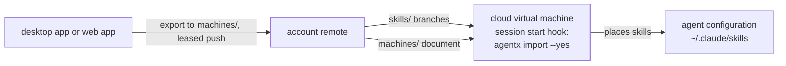

# Machine documents live on the account remote, import applies them, and every cloud agent is one machine

A machine can keep a **machine document** on the account remote, on the branch `machines/<machine id>`. The document is the one `agentx export` writes today, with one change: each skill record lists the agent configurations the skill is placed in, by client id, where it now holds a single `placed` flag. `agentx export` can write it to that branch, pushed with a lease and never forced, as a publish is; `agentx import` can read it from there as well as from a file.

`agentx import` applies the document instead of only listing it:

| What the document records | What import does |
|---|---|
| The machine settings | Replaces them, as today |
| A skill this machine lacks | Installs it: one of the user's own from the account remote, a managed skill from its source at the recorded upstream commit |
| A skill this machine holds | Sets its placements to the recorded ones, placing and removing, in the configurations detected on this machine |
| A skill at another version | Moves it forward only: fast-forwards when the recorded commit descends from the local one, keeps the local one when it descends from the recorded one, and when they diverged or the skill is modified, leaves it as it is and reports it for `skill update` |
| Nothing about a skill this machine holds | Leaves it as it is |

Import now writes the library and the placements as well as the settings, so it always asks first: one `y` confirms the whole run, and anything else changes nothing. `--yes` answers in advance and is required wherever it cannot ask, as today. A second run changes nothing. The run is one journaled mutation that touches the network; each `import_skill` event says what was done (installed, updated, placed, unplaced, kept, or skipped with the reason).

Every cloud agent environment, Claude Code on the web, Codex cloud, Cursor's cloud agents or any other, is one **cloud machine**: a machine with no computer of its own, whose machine id is derived from `AGENTX_PLATFORM_ID=cloud`, so that every virtual machine of every cloud agent client of the same user is the same machine. Its machine document is its only state. The desktop app and the web app write it; a cloud virtual machine only reads it. It never publishes, never runs `serve`, never uploads a snapshot, and needs only a read-only token for the account remote.

A cloud environment's setup script installs agentx, runs `agentx source add <account remote> --account`, and adds a session start hook to the agent client's own user settings in the virtual machine, which runs `agentx import` of the cloud machine's document with `--yes` on every session start and resume. The setup script never fails the environment: a failed install or import leaves the session to start without the skills.

## Why

A cloud agent's virtual machine is thrown away. ADR 0004 keeps a machine's state in files on that machine: a placement is a symlink on its disk, and the machine settings are a file in agentx home. Neither survives the end of a session, so the state of a cloud machine has to live somewhere that does, and the account remote already does: it holds every one of the user's own skills, it is plain git that every host serves, and it needs no service. A document there works on a bring-your-own remote as well as on a hosted one.

The export already names everything a machine needs to be rebuilt: the settings, and one lineage record per skill naming its source, subpath and version. What it lacked was where each skill is placed, and a command that acts on it. An import that only lists sends the user through one install per skill; an import that applies is the one-command restore that `export`, removing everything and `import` should always have been, on a computer as much as in a cloud.

Applying only ever adds or moves forward. Removing what a document does not list would make an import on a computer delete skills its document never knew about, so a document says what is wanted for each skill it lists and is silent about the rest. Turning a skill off is a record with no placements, which removes the skill from every configuration that is not a universal client. A cloud virtual machine starts every new session from the environment's snapshot, which holds only what its setup script left, so on a cloud machine applying comes close to a mirror without anything being deleted.

One machine for every cloud. The user decides which skills an agent works with, not which vendor runs the agent, and the per-configuration placements in the document already say which client gets what: a Claude Code virtual machine detects only Claude Code and applies only that configuration's placements. One machine id keeps the fleet to the user's computers plus one cloud, however many sessions run.

A session start hook rather than the setup script alone. The setup script runs once, and the environment's snapshot then starts every new session for up to about a week without running it again, so skills changed in the meantime would not arrive. The hook runs on every start and resume. In a Claude Code cloud session, tested on 2026-10-21, a `SessionStart` hook in the virtual machine's own `~/.claude/settings.json` ran on a fresh start and on a resume after the virtual machine was restored, a skill the hook wrote during start was available in that same session, and skills placed in `~/.claude/skills` through a symlink, agentx's default placement, were loaded. The existing CLI ran the whole round trip there: `source add --account`, `skill add --all`, `skill check-updates` and `skill update --all` brought in skills and edits a second machine published.

## Considered and rejected

A cloud sync command of its own: a second way to describe a machine's skills beside the export, and a cloud that is not a machine. The fleet view, the web app and import would each need to know it.

Keeping the cloud machine's state in the account service: it works only when signed in, and a bring-your-own remote would have no cloud machine.

A `--dry-run` that keeps today's listing: the confirmation is the guard, and the user who answers no has changed nothing, so a second mode would only be a second way to read the same document.

An import that also removes every skill the document does not list: on a computer it deletes what the user installed after the document was written; on a cloud machine it buys little, since each new session starts from the snapshot.

A machine per cloud agent client, or per environment: the fleet would grow with sessions and vendors while the user's choice is per skill and per client, which the placements already carry.

Committing the hook to each repository's own `.claude/settings.json`: it works without the user's settings, but the user wants the skills without changing every repository they work in. It stays open to users who want it.

Only skills enabled in the agent client vendor's own account: they load in every cloud session with no setup, but they are not the user's skills from the account repo, and are uploaded by hand.

## Consequences

`agentx export` gains a per-configuration placement list in each skill record, and the document's `schema_version` becomes 2; import reads version 1 as today, each `placed` flag meaning every configuration that was enabled. Import becomes a journaled mutation that fetches and installs, and its events and result change accordingly; its confirmation now covers the skills as well as the settings, and today's listing without applying is gone. Both gain a way to name a machine instead of a file, whose flag names are left to the change that builds them.

The account remote holds `machines/<machine id>` branches beside the skills' branches, one per machine that writes a document. A fetch of the account remote's skills does not fetch them; import fetches the one it reads. The machine settings leave the machine inside a document pushed there, which the glossary's "never leaves the machine" no longer covers once this is accepted; the access fields are still reset on import.

A universal client, such as Codex or Gemini CLI, sees every skill in the library, so a record with no placements does not hide a skill from it: on a cloud machine such a client gets a skill only when the document lists it, and a skill is kept from it by leaving the record out.

A skill left out of the document stays on a cloud virtual machine that already installed it, until the next new session starts from the snapshot.

Two things are not yet verified: the hook from a setup script on a brand-new cloud session, and that the cloud environment does not rewrite `~/.claude/settings.json` after the setup script ran, which is why the setup script merges its hook into the file and never replaces it. Claude Code's documentation says user settings are not read in cloud sessions; that sentence is about the user's own computer's file, and the virtual machine's own file was read in the test, which is undocumented behaviour that can change. Codex cloud and Cursor's cloud agents need their own start hook, not yet checked.

A cloud virtual machine needs a token that reads the account remote. At this stage it is written into the environment's setup script, which only the user controls, so it must be read-only and revocable.
