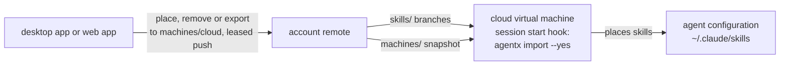

# Snapshots live on the account remote, import applies them, and every cloud agent is one machine

A **snapshot** is an inventory saved together with the machine settings. It is written by `agentx export`, to a file or, when the user names a machine, to the branch `machines/<machine id>` on the account remote, and the cloud machine's also by `skill place` and `skill remove` naming it. Each pushes with a lease and never forced, as a publish is, and only when the user runs it: nothing pushes a snapshot on its own. `agentx import` reads it from either place and applies it. The snapshot replaces the export document of lineage records: there is one description of a machine's skills, the inventory's, not two.

A snapshot keeps from the inventory what can be applied on another machine: the agent configurations by client id; each skill with its source, its subpath and its version, meaning the commit, the upstream commit and the base hash; the configurations each skill is placed in, by configuration id; and the MCP servers and plugins as found. Three rules make an inventory a snapshot:

- It leaves out what only describes the machine it was taken on: absolute paths, state and drift, scan counters and physical ids. Two exports of an unchanged machine are byte-identical.
- Import skips what it cannot install and says why, such as an unmanaged skill, which has no source. It ignores MCP servers and plugins for now.
- It may be partial. An entry needs the skill's name, its source and subpath when it is not one of the user's own, and its placements; its version and the settings are optional. An entry with no version **follows**: import takes the latest version, the account remote's tip for one of the user's own skills and the source's current version for a managed skill. An entry with a version is **exact**. A scan's inventory is always complete; only a snapshot may be partial.

A computer's state is its disk, as ADR 0004 says: a placement is a symlink there, and `skill place` and `skill remove` change it directly. A computer never needs a snapshot to work. It exports its own only as a backup it can be restored from, with every entry exact, so a restore is exact, and it can export to another machine's branch to seed it, such as "make the cloud like this machine".

The cloud machine's skills are turned on and off as a computer's are, with the same commands, naming the machine. `agentx skill place <name> --machine cloud` commits the skill's entry to `machines/cloud` where on a computer it would make a symlink, in the configurations `--to` names or, without it, in every configuration this computer enables. `agentx skill remove <name> --machine cloud --from <configuration>` takes those configurations out of the entry, and without `--from` it leaves the entry with no placements, so that a resumed session takes the skill off as well. `--remote` is refused with `--machine`, and so is a machine that is a computer, whose disk is its state: another computer is changed by an operation through the account service, never by its branch. The desktop app calls these commands from the cloud machine's row as it calls them from a computer's. The web app makes the same change by committing through the account remote host's API, or through the account service when the user is signed in, with the branch's current commit as the expected parent, so that a commit over another writer's change is refused and the writer reads the snapshot again. These commands and the web app write entries that follow and leave out the fields they cannot fill; only an export writes exact ones.

`agentx import` applies the snapshot instead of only listing it:

| What the snapshot records | What import does |
|---|---|
| The machine settings | Replaces them, as today; a snapshot without settings leaves them as they are |
| A skill this machine lacks | Installs it: one of the user's own from the account remote, a managed skill from its source, at the recorded version, or at the latest one for an entry that follows |
| A skill it cannot install | Skips it and reports the reason, such as an unmanaged skill, which has no source |
| A skill this machine holds | Sets its placements to the recorded ones, placing and removing, in the configurations detected on this machine |
| A skill at another version, or an entry that follows with a newer version available | Moves it forward only: fast-forwards when the recorded commit descends from the local one, keeps the local one when it descends from the recorded one, and when they diverged or the skill is modified, leaves it as it is and reports it for `skill update` |
| Nothing about a skill this machine holds | Leaves it as it is |
| MCP servers and plugins | Ignores them for now |

Import now writes the library and the placements as well as the settings, so it always asks first: one `y` confirms the whole run, and anything else changes nothing. `--yes` answers in advance and is required wherever it cannot ask, as today. A second run changes nothing while the snapshot, the versions it follows and the machine stay as they were; it moves an entry that follows to a newer version when one appears, and applies a skill it skipped once the reason is gone. The run is one journaled mutation that touches the network; each `import_skill` event says what was done (installed, updated, placed, unplaced, kept, or skipped with the reason).

Every cloud agent environment, Claude Code on the web, Codex cloud, Cursor's cloud agents or any other, is one **cloud machine**: a machine with no computer of its own, whose machine id is the fixed name `cloud` rather than one derived on a computer, so that its snapshot is always on `machines/cloud`, whatever virtual machine, user or vendor reads it. A cloud virtual machine never needs a machine id of its own: it writes nothing, and the hook names the snapshot it applies. Its snapshot is its only state. The desktop app and the web app write it; a cloud virtual machine only reads it. It never publishes, never runs `serve`, never uploads an inventory, and needs only a read-only token for the account remote.

Claude Code on the web is the first cloud environment this supports; Codex cloud, Cursor's cloud agents and others join as their own start hooks are confirmed. A cloud environment's setup script installs agentx, runs `agentx source add <account remote> --account`, and adds a session start hook to the agent client's own user settings in the virtual machine, which runs `agentx import` of the snapshot on `machines/cloud` with `--yes` on every session start and resume. The setup script never fails the environment: a failed install or import leaves the session to start without the skills.

## Why

A cloud agent's virtual machine is thrown away. ADR 0004 keeps a machine's state in files on that machine: a placement is a symlink on its disk, and the machine settings are a file in agentx home. Neither survives the end of a session, so the state of a cloud machine has to live somewhere that does, and the account remote already does: it holds every one of the user's own skills, it is plain git that every host serves, and it needs no service. A snapshot there works on a bring-your-own remote as well as on a hosted one.

One description of a machine, not two. The inventory already holds every field the export document wrote, each skill's source, subpath, upstream version and base hash in its library entry, and also what the export lacked: where each skill is placed. Saving the inventory with the settings is the export; applying it is the import. An import that only lists sends the user through one install per skill; an import that applies is the one-command restore that `export`, removing everything and `import` should always have been, on a computer as much as in a cloud. MCP servers and plugins are in the snapshot already, for an import that applies them later.

Applying only ever adds or moves forward. Removing what a snapshot does not list would make an import on a computer delete skills its snapshot never knew about, so a snapshot says what is wanted for each skill it lists and is silent about the rest. Turning a skill off is an entry with no placements, which removes the skill from every configuration that is not a universal client. A cloud virtual machine starts every new session from the environment's cached disk, which holds only what its setup script left, so on a cloud machine applying comes close to a mirror without anything being deleted.

One machine for every cloud. The user decides which skills an agent works with, not which vendor runs the agent, and the per-configuration placements in the snapshot already say which client gets what: a Claude Code virtual machine detects only Claude Code and applies only that configuration's placements. One machine id keeps the fleet to the user's computers plus one cloud, however many sessions run.

A session start hook rather than the setup script alone. The setup script runs once, and the environment's cached disk then starts every new session for up to about a week without running it again, so skills changed in the meantime would not arrive. The hook runs on every start and resume. In a Claude Code cloud session, tested on 2026-10-21, a `SessionStart` hook in the virtual machine's own `~/.claude/settings.json` ran on a fresh start and on a resume after the virtual machine was restored, a skill the hook wrote during start was available in that same session, and skills placed in `~/.claude/skills` through a symlink, agentx's default placement, were loaded. The existing CLI ran the whole round trip there: `source add --account`, `skill add --all`, `skill check-updates` and `skill update --all` brought in skills and edits a second machine published.

## Considered and rejected

Keeping a separate export format of lineage records beside the inventory: two descriptions of the same skills that drift apart; the inventory already holds every field the export wrote.

A command to turn skills off of its own, such as `unplace`: `skill remove --from` already takes a skill out of one configuration and keeps it on the machine, on a computer and on the cloud machine alike, and the account service's operations take the same two commands.

Every machine's placements on a `machines/<machine id>` branch of its own, pushed by agentx as a copy of its disk after each change: it gives an always current backup and a fleet view in plain Git, but the fleet view also needs presence and drift, which only the account service has, every look for a change costs a Git operation, and agentx would push on its own. It stays open as a fleet view for a bring-your-own remote with no account.

Every machine's branch as the truth of its placements, written by the web app as well as by the machine and applied to its disk: it would let the web app change a computer, but the disk and the branch would both be written, so agentx would need a two-way sync that merges against the last applied commit and never undoes what the user or another installer changed on the disk. A computer is changed from elsewhere by an operation through the account service instead: a command that runs once, under the same rules as on the computer. The cloud machine can take the branch as its truth because nothing else writes its disk and its disk does not last.

A cloud sync command of its own: a second way to describe a machine's skills beside the snapshot, and a cloud that is not a machine. The fleet view, the web app and import would each need to know it.

Keeping the cloud machine's state in the account service: it works only when signed in, and a bring-your-own remote would have no cloud machine.

Calling it a machine document or a machine snapshot: the first names a file format, not what it holds for the user; the second is a new term for what is only the inventory, saved with the settings.

A web app that writes complete entries: an import commit's id is derived by agentx from the tree it imports and its trailers, so the web app would have to repeat agentx's import to compute it. The machine that installs computes it, as every install does.

A `--dry-run` that keeps today's listing: the confirmation is the guard, and the user who answers no has changed nothing, so a second mode would only be a second way to read the same snapshot.

An import that also removes every skill the snapshot does not list: on a computer it deletes what the user installed after the snapshot was written; on a cloud machine it buys little, since each new session starts from the environment's cached disk.

Deriving the cloud machine's id on each virtual machine, as a computer's is derived: the derivation mixes in the operating system user, so a vendor that runs agentx as another user would read another branch, and a cloud virtual machine has nothing to write under an id of its own.

A machine per cloud agent client, or per environment: the fleet would grow with sessions and vendors while the user's choice is per skill and per client, which the placements already carry.

Committing the hook to each repository's own `.claude/settings.json`: it works without the user's settings, but the user wants the skills without changing every repository they work in. It stays open to users who want it.

Only skills enabled in the agent client vendor's own account: they load in every cloud session with no setup, but they are not the user's skills from the account repo, and are uploaded by hand.

## Consequences

`agentx export` writes a snapshot, the inventory's format with the rules above and the settings, in place of the export document of lineage records, and its `schema_version` becomes 2. Import still reads a version 1 export document, each lineage record an exact entry and each `placed` flag meaning every configuration that was enabled. Import becomes a journaled mutation that fetches and installs, and its events and result change accordingly; its confirmation now covers the skills as well as the settings, and today's listing without applying is gone. Both gain a way to name a machine instead of a file, whose flag names are left to the change that builds them. `skill place` and `skill remove` gain `--machine`, which today accepts only `cloud`; their result for a machine names the commit pushed to its branch in place of the placement paths.

The events change by addition only, so the output schema version stays `1`. `import_skill` keeps `state` and `local_commit`, which now describe the machine before the run, and gains `action`, one of `installed`, `updated`, `placed`, `unplaced`, `kept` and `skipped`; `reason`, present only when `action` is `skipped`, such as a modified skill, diverged histories, a skill with no source or a source that could not be fetched; and `placements`, the configuration ids the skill is placed in after the run. The `result` of an import counts each action. `export` keeps `path` and `skills` for a file; when it writes a snapshot to the account remote it leaves `path` out and carries `machine`, the machine id, and `commit`, the commit pushed to `machines/<machine id>`. The exact wording of each field is fixed in the CLI contract by the change that builds it.

The glossary calls the result of a scan an **inventory** and the saved form a **snapshot**. The CLI contract's live `snapshot` event, which carries an inventory, becomes `inventory` in the change that renames it, since "snapshot" now names the saved form; until then the specs, the Help Center and the code keep the old word, because renaming the event changes the output schema.

The account remote holds `machines/<machine id>` branches beside the skills' branches, one per machine that writes a snapshot. A fetch of the account remote's skills does not fetch them; import fetches the one it reads. The machine settings leave the machine inside a snapshot, as the glossary's machine settings now say; the access fields are still reset on import.

A universal client, such as Codex or Gemini CLI, sees every skill in the library, so an entry with no placements does not hide a skill from it: on a cloud machine such a client gets a skill only when the snapshot lists it, and a skill is kept from it by leaving the entry out.

A new computer can be set up from the snapshot of another machine: an import of the other machine's branch installs and places what it lists, once. After that the two machines are independent, as every machine's library is; nothing keeps them alike. Without a snapshot, a new computer adds the account remote and installs the user's own skills with `skill add --all`, as today, and a skill of a shared source is installed again from that source.

A skill left out of the snapshot stays on a cloud virtual machine that already installed it, until the next new session starts from the environment's cached disk.

Two things are not yet verified: the hook from a setup script on a brand-new cloud session, and that the cloud environment does not rewrite `~/.claude/settings.json` after the setup script ran, which is why the setup script merges its hook into the file and never replaces it. Claude Code's documentation says user settings are not read in cloud sessions; that sentence is about the user's own computer's file, and the virtual machine's own file was read in the test, which is undocumented behaviour that can change. Codex cloud and Cursor's cloud agents need their own start hook, not yet checked.

A cloud virtual machine needs a token that reads the account remote. At this stage it is written into the environment's setup script, which only the user controls, so it must be read-only and revocable.
