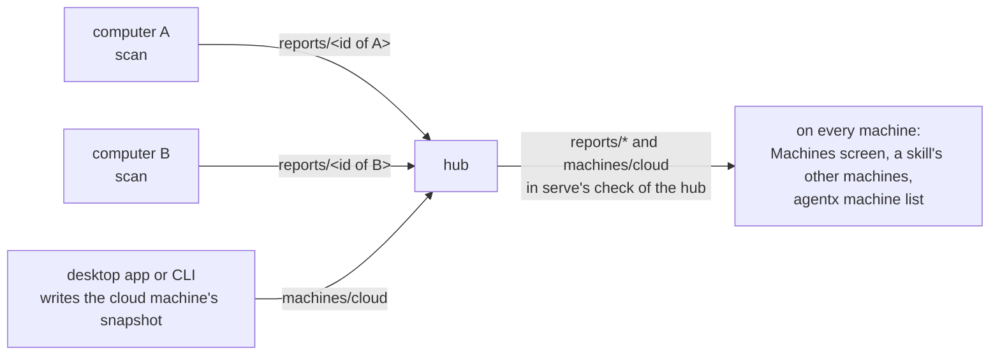

# Each machine reports its inventory to the hub, and reads the others'

The user wants to see, from any machine and at any time, which skills each of their other machines has and which agent clients see them there, the cloud machine included. Nothing answered that. An inventory never left the machine that scanned it. The one thing a machine kept on the hub was a snapshot, saved when the user asked, which lists the library's skills and none that a plugin or an agent client's own skills directory holds. And the one reader of another machine's branch was `agentx snapshot apply`, which applies what it reads.

A machine now writes an **inventory report** to the hub: what its last scan found, without what only describes that machine's disk, as the one file `inventory.json` of the branch `reports/<machine id>`. Every machine with that hub reads those branches, so a machine's skills show while it is off.

## The report

A report holds facts, and nothing a view decides:

- The machine: its id and label, its operating system and its agentx version.
- Each agent configuration by its id, with whether it is enabled and whether its client reads the library.
- Each skill an agent client sees, by name and content hash, with one occurrence for each configuration that sees it, and the plugin that brings it when one does. That covers the library's skills, a plugin's, and an unmanaged skill in an agent client's own skills directory.
- Each library skill with its kind, its logical asset, its source and subpath or its fork id, its upstream, its base version, its content hash, whether it is modified, and the configurations it is placed in.
- Each plugin by marketplace, name and version, with its configuration and whether the client has it turned on.

It leaves out every path on the machine, the machine settings, the MCP servers, whose commands, arguments and URLs can hold a secret, and the content of every skill, its description included: a report names a version and never carries one. It holds no time and no counter, so two reports of an unchanged machine are byte-identical, and the second is written nowhere.

## Who writes it

`agentx machine report` scans, and writes this machine's report. Serve writes it too while the machine setting `report_inventory` is on: after an inventory whose report differs from the one the branch holds, once the machine has been quiet for a minute, so that a run of changes makes one commit. The setting is off until the user turns it on, machine by machine.

A report is one commit on the tip of the machine's branch, pushed leased on that tip and never forced, as a publish and a snapshot are, with the user's Git identity, or the machine's when the user set none. A push the hub refuses because the branch moved writes nothing: the writer reads the branch again and reports from its next scan. Serve and the command may both write. They scan the same disk, so they write the same report. When the disk changed between their two scans, the older scan can land last, until the next report.

The cloud machine writes none. It has no scan, a cloud session holds a read-only token (ADR 0011), and its snapshot on `machines/cloud` is its whole state already.

## Who reads it

Serve's check of the hub (ADR 0015) asks for `reports/*` and `machines/cloud` in the `ls-remote` it already makes every 10 minutes, and fetches a branch only when it moved. `agentx machine list` and `agentx machine show` make the same read when the user runs them. `agentx machine remove` deletes a machine's report from the hub; a machine that still reports writes it again at its next change.

Three views read the reports: the desktop app's Machines screen, the line of a skill's details that names the other machines that have it, and the tables of the two commands. Each view matches a skill across machines by its logical asset and compares content hashes; a report says neither "same" nor "differs". The cloud machine's row comes from its snapshot, through the one reader that knows a snapshot. A snapshot holds no content hash: a view compares the cloud machine's skills by the version the snapshot names, and says nothing of a skill it names none for.

## Why

**The hub.** It is the one place every machine of the user already reaches. It needs no service and no sign-in, and it works on any Git host. ADR 0011 left this open: a fleet view in plain Git "for a bring-your-own remote with no account".

**A report of its own, apart from the snapshot.** A snapshot is made to be applied: it carries the machine settings, lists what another machine can install, and changes when the user says so. A report is made to be read: it lists everything an agent client sees, with the content hash that tells two versions apart, and it follows the disk. One document doing both would be pushed without the user asking, and would carry settings that no view reads.

**It reverses a rejection of ADR 0011.** That ADR turned down a branch per machine that agentx pushes after each change, for three reasons. The fleet view also needs presence, which only the account service has: so the views say when a machine last changed, and never that it is on. Every look for a change costs a Git operation: ADR 0015 has since made that one `ls-remote` every 10 minutes, which the reports share. And agentx would push on its own: it does now, which is why the setting is off until the user turns it on, and why a report carries names, hashes and source URLs, with no content and no settings.

**On a change, with no heartbeat.** A commit every few minutes from every machine, for as long as it runs, would buy a "last seen", which is the account service's to give. A machine that does not change writes nothing.

**A branch per machine.** Each branch has one machine writing it, so one machine's report never refuses another's.

## Considered and rejected

- Keeping each machine's snapshot current and reading that: less to build, but a plugin's skills and the skills in an agent client's own directory would not show, a skill edited on that machine would show as the version it was installed at, and "nothing pushes a snapshot on its own" would end.
- Waiting for the account service: it gives presence and a delay of seconds, and needs a sign-in and a hosted service before the user sees anything. It can carry this same report later.
- Asking the other machine directly: it answers only while it is on and reachable.
- One branch that holds a file per machine: every machine would push to one tip, and each report would refuse the next writer's lease.
- The report as a second file on `machines/<machine id>`: that branch would move without the user asking, and two writers with different rules would share it.
- On for every machine with a hub: a push nobody asked for, to a repository other people may read.
- A report forced over the one before, with no history: nothing agentx pushes is forced, and the history says when a machine's skills changed.
- Reporting MCP servers: their commands, arguments and URLs can hold a secret, and a name alone says little. A later decision.
- Cloud sessions that report what they loaded: every cloud environment would need a credential that can write. A later decision, together with which skills a session used.

## Consequences

agentx now pushes without being asked, on a machine whose user turned reporting on. "Nothing pushes a snapshot on its own" (ADR 0011) stays true. Serve's check of the hub (ADR 0015) asks for two more patterns in the same round trip and fetches the machine branches that moved, and with reporting on serve pushes too.

A change on a machine that reports shows on another machine about a minute after it settles, plus up to 10 minutes until that machine's next check, or at once with `agentx machine list`. A machine with reporting off, or with no serve running, is as current as its last `agentx machine report`, which a machine without the desktop app can run from a scheduler.

Whoever can read the hub can read the reports: machine labels, which default to the hostname, the names of skills and plugins, and source URLs. On a hub several people write to, each sees the others' machines.

A hub this machine cannot push to takes no report. Serve warns when its pushes start failing and stays quiet until one succeeds, as its checks do.

Two computers with one machine id, as a cloned disk gives, write one branch in turn; `agentx machine reset-id` gives one of them its own. A skill inside a project is in no inventory serve emits, so it is in no report.

No report reads a snapshot, and only the cloud machine's reader does, so a later change to how the cloud machine's state is kept changes that reader alone.
